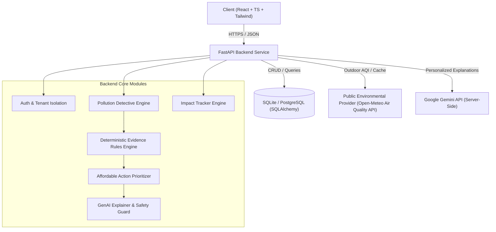

# SaaS Solution Architecture: GharKaGod

## 1. High-Level Architectural Overview

GharKaGod is designed as a secure, lightweight, accessible SaaS application targeting households and community volunteers navigating winter smog and indoor air pollution.

## 2. Core Architectural Principles

1. **Scientific Honesty First:** The system explicitly possesses zero indoor environmental sensors. The frontend and backend never fabricate or simulate indoor microgram concentrations or indoor AQI values.
2. **Deterministic Rules with AI Enhancement:** Safety rules and candidate recommendations are computed 100% deterministically from verified environmental epidemiology sources. Gemini acts as an explainer and contextualizer; it cannot invent or eliminate safety guidance.
3. **Resilience & Graceful Degradation:** If the Gemini API or outdoor AQI API is unreachable, the system automatically falls back to curated deterministic templates and cached/nearest regional baseline estimates with explicit uncertainty notices.
4. **Tenant Isolation:** Every household record, assessment, and action log is strictly bound to `user_id` / `household_id` with server-side authorization checks on all CRUD operations to prevent Insecure Direct Object References (IDOR).
5. **Zero-Setup Guest Demo:** Visitors can immediately experience the full product flow in guest mode without entering credentials, generating ephemeral in-memory or session-isolated records.

## 3. Technology Stack

### Frontend
- **Framework:** React 19 / 18 + Vite + TypeScript (Strict Mode).
- **Styling & UI:** Tailwind CSS, Lucide React icons, accessible Headless/Radix/native ARIA primitives.
- **Routing:** React Router v6.
- **State Management:** React hooks + Typed API Client with resilient error boundary states.
- **Accessibility:** Semantic HTML5, WCAG 2.2 AA compliant contrast, screen reader labels, keyboard focus rings.

### Backend
- **Framework:** FastAPI (Python 3.12+ / 3.14 compatible).
- **Validation:** Pydantic v2 with strict schemas for requests and responses.
- **ORM / Persistence:** SQLAlchemy 2.0 with async SQLite locally (`sqlite+aiosqlite` or threadpool SQLite) and documented schema migrations for PostgreSQL.
- **Security:** Argon2id / Bcrypt password hashing, JWT Bearer tokens with secure HttpOnly cookies support, strict CORS, rate limiting.
- **GenAI Client:** Google Gemini API (`google-genai` or direct authenticated HTTP with safety settings and JSON response schemas).

### External Integrations
- **Outdoor AQI:** Open-Meteo Air Quality API (Hourly PM2.5, PM10, NO2, O3, European/US AQI, no API key required, highly reliable) with fallback to CPCB/WAQI standard profiles.
- **Gemini 2.5/Flash / Pro:** Configurable server-side GenAI provider for generating plain-language household context.
